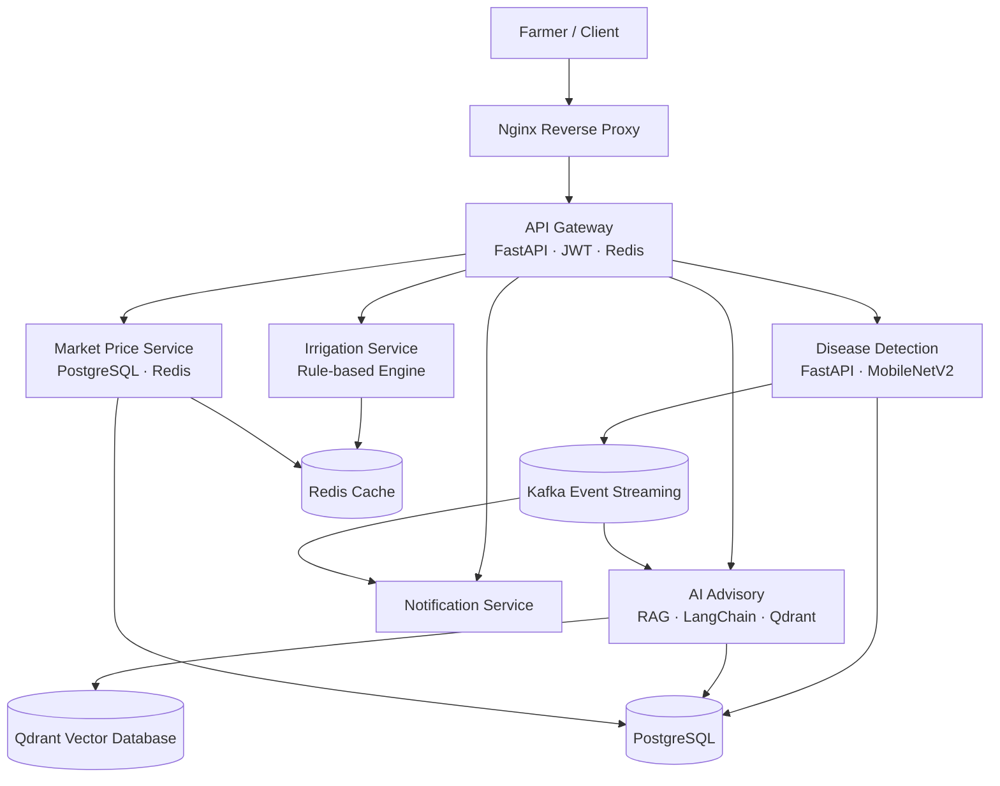
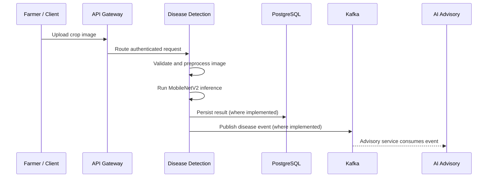
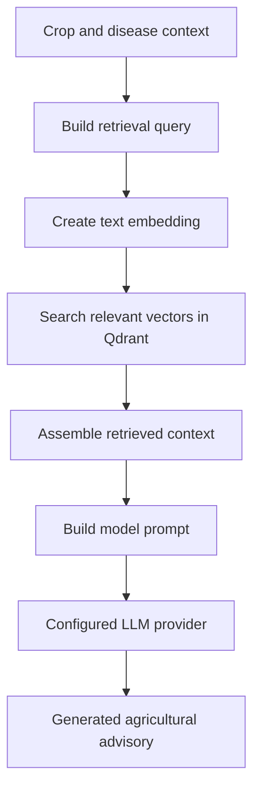

# AgriConnect

### AI-Powered Precision Agriculture Platform

AgriConnect is a microservices-based precision agriculture platform
designed to help farmers access crop disease detection, AI-assisted
treatment guidance, irrigation recommendations, and agricultural
market-price information through a unified API.

The platform combines computer vision, retrieval-augmented generation
(RAG), rule-based decision logic, event-driven communication, and shared
infrastructure to deliver agriculture-focused capabilities through a
modular backend system.

------------------------------------------------------------------------

## Table of Contents

-   [Overview](#overview)
-   [Goals](#goals)
-   [Key Features](#key-features)
-   [System Architecture](#system-architecture)
-   [Service Catalog](#service-catalog)
-   [End-to-End Workflows](#end-to-end-workflows)
-   [Technology Stack](#technology-stack)
-   [Repository Structure](#repository-structure)
-   [Prerequisites](#prerequisites)
-   [Getting Started](#getting-started)
-   [Configuration](#configuration)
-   [API Usage Examples](#api-usage-examples)
-   [API Documentation](#api-documentation)
-   [Data and Event Architecture](#data-and-event-architecture)
-   [Security and Reliability Notes](#security-and-reliability-notes)
-   [Testing and Troubleshooting](#testing-and-troubleshooting)
-   [Known Limitations](#known-limitations)
-   [Potential Future Enhancements](#potential-future-enhancements)

------------------------------------------------------------------------

## Overview

Farmers often need to make decisions using several types of information:
visible crop symptoms, crop growth stage, soil moisture, weather
conditions, and market prices. AgriConnect brings several of these
capabilities into one modular platform.

The backend is divided into independent services. The API Gateway
provides a common entry point for client requests, while specialist
services handle disease detection, agricultural advisory generation,
irrigation recommendations, market-price information, and notifications.
Shared infrastructure supports persistent storage, caching, event
streaming, and vector search.

### Core capabilities

1.  **Crop disease detection** --- accepts a crop image and uses a
    MobileNetV2-based classifier to predict a disease class.
2.  **AI-assisted agricultural advisory** --- uses a retrieval-augmented
    generation pipeline to retrieve relevant agricultural knowledge and
    generate treatment guidance.
3.  **Irrigation recommendations** --- applies crop- and
    growth-stage-based rules, with weather-related adjustments where
    supported by the implementation.
4.  **Market-price information** --- provides mandi price data and
    trend-related information.
5.  **Notifications** --- supports downstream alerts through a dedicated
    service.
6.  **Authentication and API controls** --- uses JWT authentication,
    password hashing, and Redis-backed rate limiting at the gateway.

------------------------------------------------------------------------

## Goals

AgriConnect is designed to:

-   Organize an agriculture application using a microservices
    architecture.
-   expose a unified API while keeping domain-specific functionality in
    separate services.
-   Integrate an image-classification model into an API workflow.
-   Use RAG to ground generated advisory text in retrieved agricultural
    knowledge.
-   Apply transparent, rule-based logic to irrigation recommendations.
-   Use asynchronous events to connect services without requiring every
    workflow to be a direct service-to-service HTTP call.
-   Coordinate application services and infrastructure using Docker
    Compose.

------------------------------------------------------------------------

## Key Features

  -----------------------------------------------------------------------
  Feature                             Description
  ----------------------------------- -----------------------------------
  JWT authentication                  Token-based authentication for
                                      protected API requests.

  Password hashing                    bcrypt is listed for password
                                      hashing.

  Rate limiting                       Redis-backed sliding-window rate
                                      limiting, configured for 100
                                      requests per minute according to
                                      the project description.

  Disease classification              MobileNetV2-based crop disease
                                      classification across 44
                                      PlantVillage classes, with a mock
                                      fallback.

  RAG-based advisory                  LangChain coordinates retrieval and
                                      generation using Qdrant and an
                                      OpenAI or mock provider; Ollama is
                                      also listed as a provider option.

  Irrigation engine                   Rule-based recommendations for four
                                      crops across three growth stages.

  Event-driven integration            Kafka is used for asynchronous
                                      processing; the project description
                                      identifies four topics.

  Caching                             Redis is used for selected data
                                      such as market prices, irrigation
                                      results, and sessions, as described
                                      by the project.

  API exploration                     FastAPI services expose interactive
                                      API documentation.

  Containerized deployment            Docker Compose coordinates the
                                      application and supporting
                                      infrastructure.
  -----------------------------------------------------------------------

------------------------------------------------------------------------

## System Architecture

The following diagram shows the high-level architecture described by the
project. It represents the main request path and service
responsibilities; it is not intended to specify every internal call or
event subscription.



**How to read the architecture**

-   **Nginx** is the external reverse-proxy entry point.
-   **API Gateway** is the main API entry point for authentication, rate
    limiting, and routing.
-   **Domain services** own specific capabilities rather than placing
    all application logic in one backend.
-   **Kafka** carries events between services for asynchronous
    processing.
-   **PostgreSQL** stores relational application data.
-   **Redis** supports caching and rate limiting.
-   **Qdrant** supports vector similarity search for the RAG pipeline.

The diagram is a conceptual view based on the supplied project
description. Consult the service code and `docker-compose_v2.yml` for
the exact dependencies, health checks, environment variables, and event
subscriptions.

------------------------------------------------------------------------

## Service Catalog

The ports below are taken from the supplied project README. Confirm the
host-to-container port mappings in `docker-compose_v2.yml` if they
differ in your local environment.

  -------------------------------------------------------------------------------
  Component                      Port(s) Technology             Responsibility
  ---------------- --------------------- ---------------------- -----------------
  Nginx                             `80` `nginx:alpine`         Reverse proxy and
                                                                external entry
                                                                point

  API Gateway                     `8000` FastAPI, JWT, Redis    Authentication,
                                                                rate limiting,
                                                                and request
                                                                routing

  Disease                         `8001` FastAPI, MobileNetV2,  Crop-image
  Detection                              Kafka                  classification
                                                                and event
                                                                publication

  AI Advisory                     `8002` LangChain, Qdrant,     Retrieval and
  (RAG)                                  Kafka                  generation of
                                                                agricultural
                                                                guidance

  Irrigation                      `8003` FastAPI, Redis         Rule-based
                                                                irrigation
                                                                recommendations

  Market Price                    `8004` FastAPI, PostgreSQL,   Mandi price data
                                         Redis                  and trend-related
                                                                information

  Notification                    `8005` FastAPI, Kafka         Notification and
                                                                alert processing

  PostgreSQL                      `5532` `postgres:16-alpine`   Relational
                                                                persistence

  Redis                           `6579` `redis:7-alpine`       Cache and
                                                                rate-limiting
                                                                support

  Kafka                   `9092`, `9094` `apache/kafka` (KRaft) Event streaming

  Qdrant                          `6433` `qdrant/qdrant`        Vector storage
                                                                and similarity
                                                                search
  -------------------------------------------------------------------------------

### 1. Nginx reverse proxy

Nginx accepts external HTTP traffic on port `80` and forwards requests
toward the application entry point according to `nginx/nginx.conf`. This
provides a common front door and avoids requiring clients to use each
internal service address for normal gateway access.

### 2. API Gateway

The FastAPI gateway is exposed on port `8000`. According to the project
description, it handles authentication, Redis-backed rate limiting, and
routing to domain services. JWTs are used to authenticate protected
requests.

### 3. Disease Detection

The service accepts an uploaded crop image, processes it for model
inference, and uses MobileNetV2 to classify the image. The project
describes 44 PlantVillage classes and a mock fallback. The service is
also associated with Kafka for event-driven integration.

### 4. AI Advisory (RAG)

The advisory service combines retrieval and text generation. LangChain
coordinates the RAG flow, Qdrant stores/searches vectors, and the
selected language-model provider generates the response using retrieved
context. Kafka supports asynchronous integration with other services.

### 5. Irrigation

The irrigation service calculates recommendations using crop,
growth-stage, and environmental inputs supported by its rules. The
project description identifies four crops and three growth stages. Redis
is listed as a supporting cache.

### 6. Market Price

The market-price service provides mandi price information and trends.
PostgreSQL supports persistent relational data, while Redis can reduce
repeated work for cacheable responses.

### 7. Notification

The notification service is a dedicated component for processing alerts
and notifications. Kafka is used for event-driven integration. The exact
delivery channels and triggering rules should be verified against the
service implementation.

### 8. Shared infrastructure

-   **PostgreSQL:** relational data storage.
-   **Redis:** caching and rate limiting.
-   **Kafka:** asynchronous event streaming.
-   **Qdrant:** vector storage and semantic retrieval for agricultural
    knowledge.

------------------------------------------------------------------------

## End-to-End Workflows

### Workflow A: Crop disease detection



At a high level, the client uploads an image through the gateway. The
disease service processes the image and runs classification. The service
can then persist the result and publish an event for downstream
processing, as described by the project architecture. Exact payload
fields, persistence timing, and failure behavior should be checked in
the source code.

### Workflow B: RAG-based agricultural advisory



The RAG pattern gives the language model relevant retrieved material at
generation time. The retrieval component searches the agricultural
knowledge base in Qdrant, and the generation component uses the
retrieved context to produce natural-language guidance.

**Important:** RAG does not guarantee that every generated
recommendation is correct. Model output should be validated, and the
platform should not be treated as a replacement for qualified
agricultural advice.

### Workflow C: Irrigation recommendation

1.  The client supplies crop and growing-condition inputs, such as soil
    moisture, temperature, and growth stage.
2.  The irrigation service evaluates the inputs against its configured
    rules.
3.  Where implemented, weather-related information adjusts the base
    recommendation.
4.  The service returns a recommendation to the client; Redis may be
    used for cacheable results.

This is a rule-based engine according to the supplied description, not
an ML-based irrigation prediction model.

### Workflow D: Market-price lookup

1.  The client requests prices using supported query parameters, such as
    crop and state.
2.  The market-price service retrieves the relevant data using its
    configured data source and persistence logic.
3.  Redis may serve a cached response when a valid cached entry exists.
4.  The service returns the price information and any supported trend
    data.

The supplied README does not identify the precise upstream source,
update frequency, or freshness guarantees for market data. These should
be documented from the implementation rather than assumed.

------------------------------------------------------------------------

## Technology Stack

  -----------------------------------------------------------------------
  Technology                          Role in AgriConnect
  ----------------------------------- -----------------------------------
  Python                              Main backend implementation
                                      language

  FastAPI                             HTTP API framework for the gateway
                                      and domain services

  Uvicorn                             Common ASGI server used to run
                                      FastAPI applications, if configured
                                      by the service

  Nginx                               Reverse proxy

  JWT                                 Token-based authentication

  bcrypt                              Password hashing

  PostgreSQL                          Relational database

  SQLAlchemy                          Python ORM/database interaction
                                      layer, as indicated by the shared
                                      project structure

  Alembic                             Database migration support, as
                                      indicated by the migrations
                                      directory and configuration

  Redis                               Caching and rate limiting

  Apache Kafka (KRaft)                Event streaming between services

  PyTorch / MobileNetV2               Image classification model stack

  LangChain                           RAG orchestration

  Qdrant                              Vector database for retrieval

  OpenAI / Ollama / mock provider     Configurable advisory generation
                                      options

  Docker Compose                      Local multi-service orchestration
  -----------------------------------------------------------------------

------------------------------------------------------------------------

## Repository Structure

The following structure is based on the supplied README. Individual
service folders may contain additional modules.

``` text
AgriConnect/
├── docker-compose_v2.yml       # Full-stack Docker Compose configuration
├── .env.example                # Environment-variable template
├── nginx/
│   └── nginx.conf              # Reverse-proxy configuration
├── shared/
│   ├── config.py               # Shared Pydantic settings
│   ├── database.py             # SQLAlchemy database setup
│   ├── models/                 # Shared SQLAlchemy models
│   └── schemas/
│       └── events.py           # Kafka event schemas
├── migrations/                 # Database migrations
├── alembic.ini                 # Alembic configuration
├── gateway/                    # API Gateway (port 8000)
├── disease_detection/          # Disease Detection (port 8001)
├── ai_advisory/                # AI Advisory / RAG (port 8002)
├── irrigation/                 # Irrigation Engine (port 8003)
├── market_price/               # Market Price service (port 8004)
├── notification/                # Notification service (port 8005)
└── ai_ml_models/               # MobileNetV2 disease model assets
```

------------------------------------------------------------------------

## Prerequisites

Before starting the platform, ensure you have:

-   Docker installed and running.
-   Docker Compose available (`docker compose`).
-   Git, if cloning the repository.
-   `curl` for the example API calls.
-   `jq` for extracting the access token in the shell example.
-   A crop image file, such as `sample_leaf.jpg`, for testing disease
    detection.
-   An OpenAI API key only if you choose the OpenAI provider rather than
    the mock provider.

The commands below assume a Bash-compatible shell. On Windows, use WSL
or Git Bash, or adapt the commands for PowerShell.

------------------------------------------------------------------------

## Getting Started

### 1. Get the repository

If you have not already downloaded the project, clone it using your
repository URL:

``` bash
git clone <YOUR_REPOSITORY_URL>
cd <YOUR_REPOSITORY_DIRECTORY>
```

Replace the placeholders with your actual repository URL and directory
name.

### 2. Configure environment variables

Create a local environment file from the example:

``` bash
cp .env.example .env
```

Open `.env` and review the available settings. Use `.env.example` as the
source of truth for variable names and required values. Add
`OPENAI_API_KEY` only if using the OpenAI provider.

Do not commit `.env` or real credentials to source control.

### 3. Build and start the platform

``` bash
docker compose -f docker-compose_v2.yml up -d --build
```

This asks Docker Compose to build the configured images and start the
services in the background.

### 4. Check container status and logs

``` bash
docker compose -f docker-compose_v2.yml ps
docker compose -f docker-compose_v2.yml logs -f
```

To inspect one service, use its Compose service name:

``` bash
docker compose -f docker-compose_v2.yml logs -f gateway
```

The Compose service name must match the name defined in
`docker-compose_v2.yml`.

### 5. Check the gateway health endpoint

``` bash
curl http://localhost:8000/api/v1/health
```

If you configured Nginx as the external entry point, you can also try:

``` bash
curl http://localhost/api/v1/health
```

Use the health endpoint and container logs to diagnose startup or
dependency issues.

### 6. Stop the platform

``` bash
docker compose -f docker-compose_v2.yml down
```

This stops and removes the Compose containers and network. Persistent
data behavior depends on the volumes configured in the Compose file. To
remove stored volumes, inspect the configuration and use
`docker compose down -v` only if you intentionally want to delete that
data.

------------------------------------------------------------------------

## Configuration

The exact environment-variable names and defaults are defined in
`.env.example` and the application settings. The supplied README
explicitly identifies the following advisory-provider options:

  -----------------------------------------------------------------------
  Setting                             Purpose
  ----------------------------------- -----------------------------------
  `LLM_PROVIDER=mock`                 Uses the mock provider for local testing without requiring an
                                      external LLM API key.

  `LLM_PROVIDER=openai`               Selects the OpenAI provider;
                                      requires `OPENAI_API_KEY`.

  `LLM_PROVIDER=ollama`               Selects the local Ollama provider,
                                      subject to the model and connection
                                      settings supported by the
                                      implementation.

  `OPENAI_API_KEY`                    Credential for the OpenAI provider.
                                      Do not expose or commit this value.
  -----------------------------------------------------------------------

Example setting for local testing:

``` dotenv
LLM_PROVIDER=mock
```

Example setting for OpenAI, if supported by your configured environment:

``` dotenv
LLM_PROVIDER=openai
OPENAI_API_KEY=replace_with_your_key
```

These are examples of the provider settings described in the supplied
README. Check `.env.example` for the complete list of required
variables, including database, Redis, Kafka, Qdrant, and authentication
configuration.

------------------------------------------------------------------------

## API Usage Examples

The examples below follow the routes and request fields in the supplied
README. Run them from a Bash-compatible terminal. If a request fails,
consult the interactive API docs and service logs; authentication
requirements and schemas are ultimately defined by the running
application.

### 1. Health check

``` bash
curl http://localhost:8000/api/v1/health
```

### 2. Register a farmer

``` bash
curl -X POST http://localhost:8000/api/v1/auth/register \
  -H "Content-Type: application/json" \
  -d '{
    "name": "Ravi Kumar",
    "email": "ravi@example.com",
    "password": "replace-with-a-strong-password",
    "state": "Karnataka"
  }'
```

Use a test account and a unique email address in your local environment.

### 3. Log in and capture the access token

``` bash
TOKEN=$(curl -s -X POST http://localhost:8000/api/v1/auth/login \
  -H "Content-Type: application/json" \
  -d '{
    "email": "ravi@example.com",
    "password": "replace-with-the-password-used-at-registration"
  }' | jq -r '.access_token')

echo "$TOKEN"
```

If `TOKEN` is empty or `null`, inspect the login response before
continuing. The JSON field name shown here is based on the supplied
README.

### 4. Upload a crop image for disease detection

Place a test image at `sample_leaf.jpg`, or replace the path with a
valid local image path:

``` bash
curl -X POST http://localhost:8000/api/v1/detect \
  -H "Authorization: Bearer $TOKEN" \
  -F "file=@sample_leaf.jpg"
```

The response format and supported file types are defined by the running
service. A mock fallback may not represent a real model prediction.

### 5. Request an irrigation recommendation

``` bash
curl -G "http://localhost:8000/api/v1/irrigation" \
  -H "Authorization: Bearer $TOKEN" \
  --data-urlencode "crop=rice" \
  --data-urlencode "soil_moisture=35" \
  --data-urlencode "temperature=32" \
  --data-urlencode "growth_stage=vegetative"
```

The example uses the parameters provided in the original README. Check
the service schema for accepted values, units, and validation rules.

### 6. Check market prices

``` bash
curl -G "http://localhost:8000/api/v1/market-prices" \
  -H "Authorization: Bearer $TOKEN" \
  --data-urlencode "crop=rice" \
  --data-urlencode "state=Karnataka"
```

Price availability and freshness depend on the configured data source
and implementation.

------------------------------------------------------------------------

## API Documentation

FastAPI typically provides interactive OpenAPI documentation when
enabled. Use the URLs below after the services have started.

  Service                 Documentation URL
  ----------------------- ------------------------------
  API Gateway via Nginx   `http://localhost/docs`
  API Gateway directly    `http://localhost:8000/docs`
  Disease Detection       `http://localhost:8001/docs`
  AI Advisory             `http://localhost:8002/docs`
  Irrigation              `http://localhost:8003/docs`
  Market Price            `http://localhost:8004/docs`
  Notification            `http://localhost:8005/docs`

Direct service URLs require the relevant ports to be published to the
host. If a documentation page is unavailable, verify the Compose port
mappings and service startup logs.

------------------------------------------------------------------------

## Data and Event Architecture

### PostgreSQL

PostgreSQL is the relational storage component. The repository includes
shared SQLAlchemy models and database configuration, plus Alembic
migration files/configuration. Consult those models and migrations to
identify the exact tables, fields, and relationships.

### Redis

Redis is used for caching and rate-limiting support. The project
description mentions cache use for market prices, irrigation, and
sessions. Cache expiration, invalidation, and fallback behavior depend
on the service implementation.

### Kafka

Kafka provides event streaming for asynchronous service integration. The
supplied project description identifies four topics, but does not list
their exact names or message schemas here. The shared
`schemas/events.py` file is the indicated place to inspect event
definitions.

For a complete event reference, document each topic with:

-   Topic name.
-   Producing service.
-   Consuming service(s).
-   Event schema and required fields.
-   Retry and failure-handling behavior.
-   Delivery and ordering assumptions.

### Qdrant and the RAG knowledge base

Qdrant stores vectors used for similarity search in the advisory
pipeline. At a high level, agricultural text is represented as
embeddings, relevant items are retrieved for a query, and the retrieved
context is supplied to the configured language model.

The exact embedding model, collection name, document-ingestion process,
similarity configuration, and source of the agricultural documents
should be confirmed from the code and configuration before being
specified more precisely.

------------------------------------------------------------------------

## Security and Reliability Notes

The project description identifies several security-related components,
but their production suitability depends on configuration and
implementation.

-   **Secrets:** Keep API keys, database credentials, signing secrets,
    and other sensitive values in local environment configuration or a
    suitable secrets manager. Never commit real secrets.
-   **Passwords:** bcrypt is listed for password hashing. Verify that
    the implementation uses an appropriate work factor and safe
    password-handling practices.
-   **JWT:** Protect signing keys and validate token expiry, signature,
    and relevant claims.
-   **Rate limiting:** The described gateway rate limit is 100 requests
    per minute. Verify whether limits are applied per user, IP address,
    token, or another key.
-   **Image uploads:** Validate file size and type, handle malformed
    images, and avoid trusting client-provided filenames.
-   **Agricultural advice:** Treat generated guidance as decision
    support. RAG and model output can still be incomplete or incorrect.
-   **Market information:** Show timestamps or source details where
    possible so users can assess price freshness.
-   **Event processing:** Consider retries, idempotency, dead-letter
    handling, and monitoring for asynchronous consumers.
-   **Persistence:** Confirm database backups and volume configuration
    before storing important data.
-   **Network exposure:** Avoid exposing internal databases, caches,
    vector databases, or message brokers to untrusted networks.

These are documentation and review recommendations, not claims that
every control is already implemented.

------------------------------------------------------------------------

## Testing and Troubleshooting

### Check service status

``` bash
docker compose -f docker-compose_v2.yml ps
```

### Inspect logs

``` bash
docker compose -f docker-compose_v2.yml logs --tail=200
```

For a specific service:

``` bash
docker compose -f docker-compose_v2.yml logs --tail=200 disease_detection
```

Use the service names defined in the Compose file.

### Common issues

  -----------------------------------------------------------------------
  Symptom                             Checks
  ----------------------------------- -----------------------------------
  A container exits during startup    Inspect its logs and verify
                                      required environment variables.

  Gateway endpoint is unreachable     Check gateway status, port
                                      mappings, and Nginx configuration.

  Login fails                         Check the registration response,
                                      credentials, database connectivity,
                                      and authentication settings.

  Protected endpoint returns an       Verify that login returned a valid
  authorization error                 access token and that the request
                                      uses
                                      `Authorization: Bearer <token>`.

  Disease endpoint rejects the image  Check the path, multipart field
                                      name (`file`), image format, and
                                      size restrictions.

  Advisory provider fails             Verify `LLM_PROVIDER`, provider
                                      configuration, credentials, and
                                      local model availability if using
                                      Ollama.

  Kafka-dependent behavior does not   Inspect broker health, topic
  occur                               configuration, producer/consumer
                                      logs, and event schemas.

  Cached values appear stale          Review cache TTL and invalidation
                                      behavior in the relevant service.

  API docs do not load                Confirm the service is running, the
                                      port is published, and OpenAPI docs
                                      are enabled.
  -----------------------------------------------------------------------

### Validation note

A successful container startup or health check does not guarantee that
every business workflow behaves correctly. Test each feature's expected
behavior, including invalid input and failure cases.

------------------------------------------------------------------------

## Known Limitations

Based on the supplied project description:

-   Disease classification includes a mock fallback; mock results should
    not be treated as real predictions.
-   The irrigation engine is described as rule-based, not as a trained
    ML prediction system.
-   The advisory pipeline can generate incorrect or incomplete guidance
    even when retrieval is enabled.
-   The supplied README does not specify the exact external source or
    freshness guarantees for market prices.
-   The supplied README does not enumerate the four Kafka topic names or
    their full schemas.
-   The supplied README does not provide a complete list of environment
    variables or all API request/response schemas.

These details should be completed by checking the relevant source files
before presenting the platform as production-ready.

------------------------------------------------------------------------

## Potential Future Enhancements

The following are possible future improvements, not claims about
existing functionality:

1.  Add stronger input validation and automated tests for every service.
2.  Introduce confidence thresholds and a safe fallback for uncertain
    disease classifications.
3.  Add agricultural expert review and source attribution for
    high-impact treatment recommendations.
4.  Display data source and last-updated timestamps for market prices
    and weather-dependent results.
5.  Add end-to-end tracing, structured logs, metrics, and service-level
    health checks.
6.  Strengthen Kafka retry, idempotency, and failed-message handling.
7.  Add role-based authorization and centralized secret management where
    appropriate.
8.  Expand crop and regional coverage using validated agricultural
    datasets.
9.  Improve accessibility and localization for farmers using different
    languages and devices.
10. Add deployment documentation, backup procedures, and a production
    security review.

------------------------------------------------------------------------


## License

No license information was included in the supplied README. Add a
`LICENSE` file and update this section before distributing the project
if you intend to publish it for reuse.
